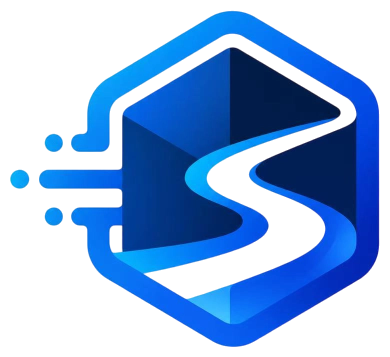

<div align="center">
  

  <h1>streamind</h1>

  <p><b>事件驱动的 AI Agent 运行时</b></p>
  <p><sub>LLM 是常驻进程，不是一问一答的接口</sub></p>

  <p>
    
    
    
    
    
  </p>

  <p>
    <a href="#快速开始">快速开始</a> ·
    <a href="#事件循环">事件循环</a> ·
    <a href="#模型输出协议">输出协议</a> ·
    <a href="#前端">前端</a> ·
    <a href="#打包与部署">打包</a> ·
    <a href="#安全须知">安全须知</a>
  </p>
</div>

---

streamind 把大模型当作一个**长期运行的进程**：用户输入、定时器、工具结果、心跳、异常都是**事件**，
进入队列后由 Agent 在「流」里消费；模型输出的每一段（思考 / 回复 / 工具调用 / 组件渲染）会被解析成**新的指令**，
再变成事件回到队列 —— 循环往复，直到任务结束。

> **状态：早期开发（0.1.0）。** 表结构由实体自动同步，接口与提示词协议仍在快速演进。
> 文档与代码不一致时以代码为准，欢迎顺手修正。

## 它有什么不一样

<table>
<tr>
<td width="50%" valign="top">

**上下文是栈，不是窗口**

模型用 `<push>` / `<pop>` / `<reset>` 自己管理注意力。长任务里可以为一个临时话题开一层栈，做完弹掉，主线不丢。

</td>
<td width="50%" valign="top">

**过程可见**

输出按分节流式推送（SSE）：思考、工具调用参数、工具结果、回复、渲染组件各自独立，前端可以做真正的「过程可视化」。

</td>
</tr>
<tr>
<td width="50%" valign="top">

**条件反射，不靠 RAG**

用关键词 / 正则 / 向量相似度 / 时间表达式绑定「触发条件 → 注入内容」。命中就直接把经验反射进上下文，比检索更可控。

</td>
<td width="50%" valign="top">

**模型生成 UI**

模型输出 `<render>` 标签，运行时实例化前端注册的 Vue 组件。界面不再是写死的，而是对话的一部分。

</td>
</tr>
<tr>
<td width="50%" valign="top">

**可中断、可分叉**

主流运行中能派生支流处理新事件，支流还能请求打断主流并把控制权交回。

</td>
<td width="50%" valign="top">

**一切落库**

事件、分节、栈节点、工具结果都在 SQLite 里，断点续跑和事后复盘不需要额外埋点。

</td>
</tr>
</table>

## 事件循环

```text
  事件
    ↓   用户输入 / 定时器 / 工具结果 / 心跳 / 异常
  上下文（栈）
    ↓   栈顶节点 + 条件反射注入
  LLM 流
    ↓   流式 token
  分节
    ↓   think / reply / tool_call / render / push / pop
  拦截与执行
    ↓
  工具调用 · 栈操作 · 组件渲染  ──▶  新事件回到队首
```

## 快速开始

**1 · 准备** — Rust ≥ 1.85（子 crate 用 edition 2024）、本机 Chrome；跑前端另需 Node ≥ 20 与 pnpm。

**2 · 配置**

```powershell
Copy-Item .env.example .env
notepad .env              # 填 JWT_SECRET_KEY 与 EMBEDDING_* 四项
```

**3 · 启动**

```powershell
cargo run
```

首次启动会自动建表，并打印一个一次性登录码：

```text
INFO streamind: 存储服务初始化成功!
INFO streamind: 智能体运行时初始化成功!
INFO streamind: Starting streamind AI Client
INFO streamind: Generated login code:
 【 a1b2c3d4 】
```

用它换 JWT：`curl "http://localhost:3000/api/login?code=a1b2c3d4"`。

<details>
<summary><b>完整环境变量表</b></summary>

| 变量 | 必填 | 默认 | 说明 |
| --- | --- | --- | --- |
| `PORT` | 是 | — | HTTP 端口，缺失直接启动失败 |
| `DATABASE_URL` | 是 | — | `sqlite://streamind.db?mode=rwc` |
| `JWT_SECRET_KEY` | 是 | — | 签名密钥，≥ 16 字符，缺失直接启动失败 |
| `JWT_EXPIRATION_MINUTES` | | `600` | Token 有效期（分钟） |
| `EMBEDDING_API_KEY` | 是 | — | 向量模型密钥 |
| `EMBEDDING_API_URL` | 是 | — | 如火山方舟 `/api/v3/embeddings/multimodal` |
| `EMBEDDING_MODEL` | 是 | — | 如 `doubao-embedding-vision-251215` |
| `EMBEDDING_DIM` | 是 | — | 必须与 `sql/init.vec.sql` 的 `FLOAT[1024]` 一致 |
| `BASE_URL` | | — | 对外地址，用于把下载的渲染依赖改写成绝对 URL |
| `WEB_UI_DIR` | | `./public/web` | 控制台静态站点目录 |
| `CHROME_PATH` | | 系统默认 | 浏览器工具的 Chrome 路径 |
| `HEARTBEAT_INTERVAL` | | 代码内默认 | 心跳间隔（humantime） |
| `CONTEXT_SIZE_LIMIT` | | `1 MiB` | 单次上下文体积上限 |
| `TOOL_CALL_TIME_OUT` | | 代码内默认 | 工具调用超时 |
| `TOOL_RESULT_SIZE_LIMIT` | | 代码内默认 | 工具结果截断阈值 |

模型密钥存在数据库的 `model` 表，可从前端「模型」页维护，也可以：

```sql
update model set api_key = 'sk-你的密钥' where id = 1;
```

</details>

<details>
<summary><b>为什么必须从仓库根目录启动</b></summary>

`prompts/`、`sql/`、`public/`、`reader/`、`workspace/` 全是**相对当前工作目录**的路径。
换个目录启动会读不到提示词，或者把运行时数据写到别处。

</details>

## 模型输出协议

模型不返回 JSON，而是返回带标签的文本流；解析器边收边切，前端边收边渲染。

| 标签 | 作用 | 处理位置 |
| --- | --- | --- |
| `<think>…</think>` | 思考过程，只展示不进上下文 | 分节直出 |
| `<reply>…</reply>` | 给用户的回复 | 分节直出 |
| `<tool_call id="a1">pkg.fn(args)</tool_call>` | 工具调用 | `kernel/tool/engine.rs` |
| `<recall>…</recall>` | 主动触发条件反射 | `src/runtime/reflect_call.rs` |
| `<render><Comp attrs={...} /></render>` | 实例化前端组件 | `kernel/render` → `RemoteComponent.vue` |
| `<push title="…">…</push>` | 压入临时栈节点 | `src/runtime/stack_call.rs` |
| `<pop/>` · `<reset/>` | 出栈 · 重置栈顶 | `src/runtime/stack_call.rs` |

<details>
<summary><b>一个完整回合长什么样</b></summary>

```xml
<think>用户想了解北京的天气，我需要调用天气查询工具…</think>
<tool_call id="a1">http.request(method="get",url="https://example.com/weather")</tool_call>
<push title="临时上下文">正在查天气，先把主线放一放。</push>
<reply>北京今天晴，约 25 摄氏度。</reply>
<render>
  <ImageList title="实时天气" attrs={"width":100,"images":[{"name":"晴","path":"/public/weather.png"}]} />
</render>
```

提示词在 `prompts/` 下，按工作目录相对路径读取，改完重启即可生效。

</details>

## HTTP 与 SSE

统一响应体 `{ code, data, message }`。

| 方法 | 路径 | 说明 |
| --- | --- | --- |
| GET | `/api/login?code=` | 用启动日志里的登录码换 JWT |
| GET | `/api/agent/connect/{id}` | **SSE** 事件流 |
| POST | `/api/agent/chat/{id}` | 发送用户消息 |
| POST | `/api/agent/user_interrupt/{id}` | 打断当前回合 |
| POST | `/api/agent/ui_interaction/{id}` | 组件交互回传 |
| GET | `/api/event/*` · `/api/section/*` · `/api/state/*` | 历史事件 / 分节 / 栈状态 |
| CRUD | `/api/model/*` · `/api/render_component/*` · `/api/render_dependence/*` | 模型与渲染组件配置 |
| POST | `/upload/{*path}` | 上传文件到 `public/` |
| GET | `/public/*` | 静态资源 |

SSE 帧形如：

```json
{ "bind_event_id": 12, "event": "section", "type": "chunk",
  "data": { "tag": "think", "chunk": "让我先看看…" } }
```

`event` 是类别（`server` / `section` / `tool_call` / `env`），`type` 是动作
（`start` / `open` / `chunk` / `close` / `end` …）。

## 数据模型

<details>
<summary><b>数据表一览</b></summary>

SQLite + `sqlite-vec`，向量表维度固定 1024（见 `sql/init.vec.sql`）。

| 表 | 说明 |
| --- | --- |
| `agent` | Agent 实例：模型、父级、当前栈节点、workspace、工具包 |
| `model` | LLM 配置：api_url / api_key / 模态 / 成本档 |
| `state` | 上下文栈节点（`pos=0` 为根） |
| `event` | 事件流水 |
| `section` | 模型输出分节 |
| `item` | 结构化条目 |
| `rule_concept` / `rule_scope` / `rule_item` | 条件反射：概念 / 作用域 / 规则 |
| `render_component` / `render_dependence` / `render_state` | 远程渲染 |
| `agent_permission` / `agent_timer` / `task_queue` | 权限 / 定时 / 任务队列 |

建表方式：启动时 SeaORM `schema_registry.sync()` 对齐实体，再执行 `sql/init.vec.sql` 建向量表。
`sql/init.data.sql` 是种子数据（模型 / Agent / 组件 / 依赖），`sql/reset.sql` 用来清空 1 号 Agent 的会话。

</details>

## 目录结构

<details>
<summary><b>展开完整目录树</b></summary>

```text
streamind/
├── src/                  # 二进制入口与业务编排
│   ├── main.rs           # 启动：dotenv → DB → runtime → HTTP
│   ├── global.rs         # AGENT_POOL / MODEL_POOL / 向量客户端 / 调度器
│   ├── agent_api.rs      # Agent 会话接口（chat / connect / interrupt）
│   ├── sse_event.rs      # WebEvent → SSE 帧
│   ├── agent/            # AppAgent、MemoryAgent
│   ├── runtime/          # 回合调度、工具/栈/召回调用
│   ├── plugin/           # 心跳、定时、权限、日志、记忆、反射
│   └── task/             # 向量化后台任务
├── kernel/               # 内核：mind / parser / tool / render / permission
├── runtime/              # LLM、嵌入、上下文、Agent 事件
├── entity/               # SeaORM 实体
├── entity_service/       # 数据访问 + DB 初始化
├── web_api/              # axum HTTP 层、SSE、静态托管
├── tool/tool_macro/      # #[package] / #[tool] 过程宏
├── tool/tool_pkg/        # 内置工具：browser/editor/file/http/timer/reflect…
├── reflection/           # 条件反射算子与规则引擎
├── rule_script/          # 规则表达式 DSL（pest）
├── mcp/                  # MCP 客户端（骨架）
├── web_ui/               # 控制台前端（Vue 3 + Vite）
├── web_render/           # 远程渲染组件（Vite lib 模式）
├── prompts/              # 系统提示词与规则模板
├── reader/               # 编辑器工具的语言模式分隔符
├── sql/                  # 向量表 / 种子数据 / 重置脚本
├── scripts/              # 打包与密钥自检
├── docs/                 # 设计与规划文档
├── public/               # 运行时静态根（git 忽略）
├── workspace/            # Agent 运行时目录（日志、浏览器 profile）
└── dist/                 # 打包产物（git 忽略）
```

</details>

## 前端

界面是两个 Vue 3 项目，和后端同仓：

| 目录 | 作用 | 产物 |
| --- | --- | --- |
| `web_ui/` | 控制台：对话、过程可视化、Agent / 模型 / 组件管理 | `web_ui/dist` → `public/web` |
| `web_render/` | 模型 `<render>` 标签可实例化的组件 | `dist/<Name>/index.js` → `public/components` |

```powershell
pnpm -C web_ui install
pnpm -C web_ui dev        # http://localhost:5173，已代理 /api 与 /public 到 :3000
```

后端在站点根托管 `public/web` 并对未命中路由回退 `index.html`，
所以**打包后直接访问 `http://localhost:3000` 就是控制台**，前端路由刷新不会 404。

细节（契约、新增组件流程、为什么不用 submodule）见 [docs/ui-monorepo.md](docs/ui-monorepo.md)。

## 打包与部署

```powershell
pwsh -File scripts/package.ps1
```

依次构建 `web_render` → `web_ui` → `cargo build --release`，组装成可直接运行的目录并打 zip：

```text
dist/streamind-0.1.0-windows-x64/
├── streamind.exe
├── start.ps1              # 首次运行生成 .env 并提示填密钥
├── .env.example  README.md
├── prompts/  reader/  sql/
└── public/
    ├── dom_view.js  fingerprint_cheat.js
    ├── components/<Name>/index.js
    └── web/               # 控制台
```

```powershell
cd dist/streamind-0.1.0-windows-x64
.\start.ps1        # 第一次会生成 .env，填好密钥再跑一次
# 浏览器打开 http://localhost:3000
```

常用开关：`-SkipWebUI` / `-SkipRender` / `-SkipRust` 分步重打，`-NoZip` 只出目录，`-SkipInstall` 跳过 pnpm install。

## 安全须知

- **本仓库早期提交过真实 API Key**（DeepSeek / SiliconFlow / 火山方舟），历史里的密钥请视为已泄露并吊销重发。
- `.env`、`*.db`、`public/`、`workspace/`、`tempb/` 已加入 `.gitignore` 并从索引移除。
- 提交前自检：`pwsh -File scripts/check-secrets.ps1`（默认扫暂存区，`-All` 扫全部受跟踪文件）。
- 需要彻底清理历史时（会重写所有提交哈希）：

```bash
git filter-repo --invert-paths --path .env --path streamind.db
```

- **JWT 中间件目前是注释状态**（`web_api/src/feature/auth.rs`），登录成功也不会强制校验 —— 不要直接暴露到公网。
- 默认监听 `0.0.0.0`；只在本机用请改成 `127.0.0.1`。
- 浏览器工具会以你的身份操作本机 Chrome，`file_*` / `editor_*` 可以读写磁盘，只在可信环境运行。

## 开发与调试

```powershell
cargo check --workspace        # 类型检查
cargo run                      # 启动后端
cargo test --workspace         # 33 项单元测试
$env:RUST_LOG="debug"; cargo run
```

- 另有 2 项依赖真实环境的集成测试默认 `#[ignore]`（真实数据库 / 本机 Chrome），用 `-- --ignored` 手动跑。
- 日志同时写 stdout 和 `workspace/<code>/log/*.txt`。
- 重置 1 号 Agent 会话：执行 `sql/reset.sql`；重建向量索引：删掉 `vec_concept` / `vec_scope` 后重启。

## 已知问题

<details>
<summary><b>展开</b></summary>

- 鉴权中间件未启用；CORS 白名单与前端端口写死 `localhost:5173`。
- `mcp` crate 只有骨架，未接入工具池。
- 仓库没有统一 `rustfmt` 约束，CI 只跑 check / test，不跑 `fmt --check` 与 `clippy -D warnings`。
- `web_ui` 打包后有 4MB 级 vendor chunk，尚未做代码分割。
- `workspace/` 会持续增长（浏览器 profile、日志、截图），需要定期清理。

</details>

## 文档

- [docs/ui-monorepo.md](docs/ui-monorepo.md) — 前端目录、三方契约与构建流程
- [idea.md](idea.md) — 最初的运行时设计草案（事件流、反射、栈、渲染）
- [entity.md](entity.md) — 早期实体设计

## 许可证

尚未指定。默认保留所有权利，如需开源请补充 `LICENSE`。
